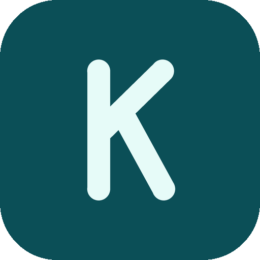

# Koymic

A manga reader for Android, forked from [Mihon](https://github.com/mihonapp/mihon), with an optional
**account system that syncs your library and reading history** between devices.

## What's different from Mihon

- Own name, icon and package ID (`io.github.arlodevio.koymic`), so it installs next to Mihon.
- **Account & sync** (Settings → Account & sync): sign in with a username and password. Koymic then syncs
  your library, categories, chapter read/bookmark/last-page state, reading history and tracker links through
  Supabase. It works fully offline and signed out too; the account is optional.
- Everything else (sources through extensions, reader, downloads, tracking) is Mihon.

## Install

Download the APK that matches your phone from the [Releases](../../releases) page (`arm64-v8a` for most
phones, or the universal one if unsure).

## Setting up your own backend and builds

See [docs/SETUP.md](docs/SETUP.md): Supabase SQL, the one dashboard switch to flip, signing key and releases.

## Privacy

See [PRIVACY.md](PRIVACY.md).

## Credits and license

Koymic is a fork of Mihon and keeps its Apache-2.0 license and copyright notices (see [LICENSE](LICENSE)).
Mihon is a continuation of Tachiyomi. Koymic is not affiliated with or endorsed by the Mihon project.
The Koymic name and logo are original; the Mihon name and logo are not used.
